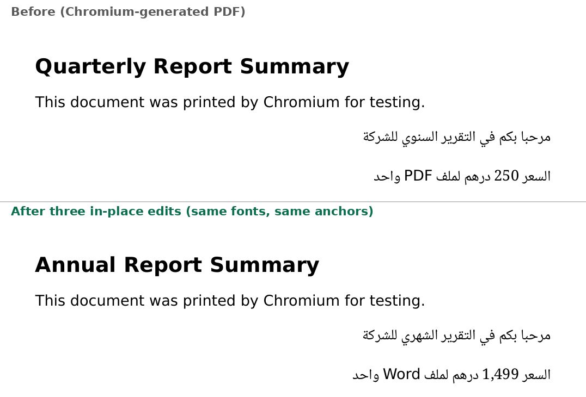

# pdf-inplace-edit

In-browser, **in-place** editing of existing PDF text: English, Arabic and mixed Arabic/English/digit lines. You click a line, change a word and save. The new text goes into the same content stream at the same anchor, in the **original embedded font**, with properly joined (shaped) Arabic in right-to-left order. Nothing is uploaded: TypeScript, pdf.js, pdf-lib, fontkit, HarfBuzz (WASM), all on the device.



*Top: a PDF printed by Chromium. Bottom: the same file after three in-place edits: the bold heading (`Quarterly` → `Annual`), an Arabic word (`السنوي` → `الشهري`), and a mixed line (`250 … PDF` → `1,499 … Word`). Every other line is pixel-identical. See [`docs/sample-edited.pdf`](docs/sample-edited.pdf).*

## Run it

```bash
npm ci
npm run dev            # open the printed URL, "Load sample" or open your own PDF
npm test               # unit + golden tests (needs qpdf and poppler-utils)
npm run test:e2e       # Playwright, against the production build
```

## How an edit works

1. **Interpret the content stream.** A small lossless tokenizer keeps the byte range of every operator. An interpreter replays the PDF text model (`Tm`/`Tlm`, `Tc`, `Tw`, `Tz`, `TL`, `Ts`, `TJ` adjustments, `cm`, `q/Q`, marked content) so every glyph gets an exact origin and advance. pdf.js renders the page and maps clicks to PDF space. Its operator list drops the byte offsets needed for splicing, so locating the run happens here.
2. **Rebuild the line's logical text.** Glyphs are grouped into visual lines (tolerant of mark glyphs that sit off the baseline). Text comes from ActualText spans, ToUnicode, or the identified font's cmap, and is converted from visual to logical order.
3. **Lay out the new text.** UAX #9 bidi levels (`bidi-js`) split the text into runs. Each run gets the font the line already used for that character or script. Runs are shaped with HarfBuzz using the whole string as context, so joining across run boundaries is right.
4. **Encode into the original font.** Real-world subsets are renumbered and stripped of `cmap`/`GSUB` (Chromium's are), so the engine **identifies the embedded subset by comparing glyph outlines** against a known full font. That yields an exact full-GID ↔ subset-GID map:
   - all shaped glyphs exist in the subset → re-encode in the original font (`original`)
   - some glyphs are missing → re-subset the same full font to the union of old and new glyphs (HarfBuzz subsetter, retained GIDs), swap the font program in place and remap `CIDToGIDMap` so existing CIDs still draw the same glyphs (`original-extended`)
   - the font can't be identified → embed a subset of a bundled font matched on weight, and report it as `substitute`
5. **Splice the stream.** Delete the old show operators and any marked-content pairs that only wrapped them (stale `ActualText` / `/ReversedChars`). Insert one `TJ` per run at the original anchor: the **right edge for RTL lines, the left edge for LTR**. Per-glyph `TJ` adjustments reproduce HarfBuzz advances exactly, including `Tc` and `Tz`. `Tw` is honoured with the PDF rule that it only applies to the single-byte code 32. Mark offsets use `Ts`. Text state, `Tm` and `Tlm` are then restored, so untouched operators in the same text object land exactly where they did before.
6. **Fix ToUnicode.** New glyphs get their own CIDs (aliases through `CIDToGIDMap`), so each one has an unambiguous ToUnicode entry, even when one dot glyph is shared by ب ت ث ن ي. Existing mappings are never changed. The edited text extracts and searches correctly in pdf.js and poppler.

### A word whose glyphs are missing from the embedded subset

This is the hard case, and the order of preference matters:

1. **Identify the full font by outline matching.** BaseFont names lie and subsets are renumbered, so outlines are compared instead.
2. **Grow the original subset in place.** Same font, same resource, same name. Every existing CID is remapped to identical glyphs, verified before the swap. If any existing glyph can't be matched, the engine does not risk it.
3. **Otherwise add a separate subset of the same font.** It looks identical, but it is a second font resource.
4. **Only then substitute** Noto Naskh Arabic or DejaVu Sans, matched on weight, and say so in the edit report. It never writes `.notdef` or silently drops glyphs.

## Tests

| Case | What is checked |
| --- | --- |
| English bold heading, Arabic word, mixed Arabic/English/digits | `qpdf --check` passes · original font kept, no substitution · re-opened file reads the new logical text · `pdftotext` (poppler, independent of this code) extracts the new text, other lines unchanged · anchor edge preserved (right for RTL, left for LTR) · **rendered line matches Chromium typesetting the new sentence** (golden pixel diff) · every other line pixel-identical |
| Missing glyphs | subset is grown in place (`original-extended`) when the font is identified |
| Unknown font | bundled substitute, warning reported, output still valid |
| Second edit on an edited line | works on the already-modified stream and fonts |
| pdf-lib producer | standard-14 Helvetica-Bold (single-byte WinAnsi, AFM widths), Type0 with existing ToUnicode |
| Playwright | the three cases run in the production build in Chromium; UI flow click → edit → save; asserts **zero external network requests** |

Fixtures are generated by Chromium's own PDF backend (`npm run fixtures`), a real producer: HarfBuzz-shaped Arabic, renumbered subsets without GSUB, per-letter ActualText, `/ReversedChars`.

## Phase-1 limits (deliberate)

- No paragraph reflow. A longer replacement extends from the anchor, and the report warns when it may overlap nearby content.
- Text inside Form XObjects, Type3 fonts, bare CFF (`FontFile3/CIDFontType0C`) and non-Identity CMaps are reported as not editable rather than guessed at.
- Vertical writing is out of scope.
- An operator that mixes the clicked line with other text is refused, not split.

## Licences

Code: MIT. Fonts: Noto Naskh Arabic (SIL OFL 1.1), DejaVu Sans (Bitstream Vera / DejaVu licence). See `fonts/`.
